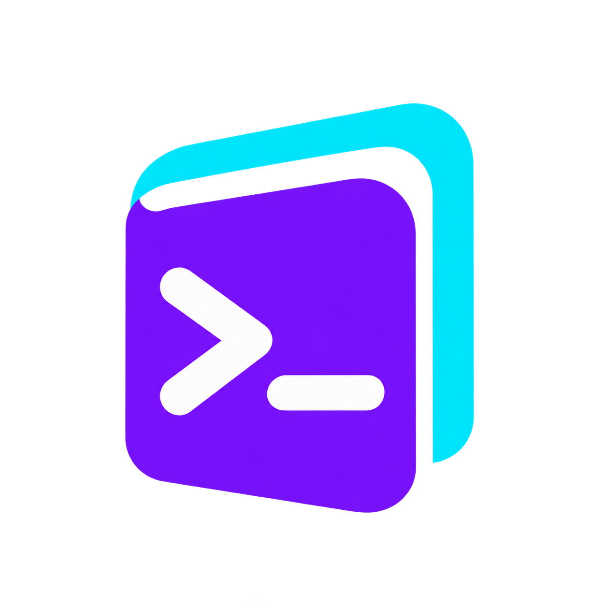

<p align="center">
  
</p>

<h1 align="center">Prompt Library</h1>

<p align="center">
  <em>Your prompts, wherever you work.</em>
</p>

<p align="center">
  <a href="https://github.com/illegalstudio/prompt-library/stargazers"></a>
  <a href="https://github.com/illegalstudio/prompt-library/releases"></a>
  <a href="https://github.com/illegalstudio/prompt-library/releases/latest"></a>
  <a href="LICENSE"></a>
</p>

<p align="center">
  <strong>Global &amp; project prompts &middot; Git sync &middot; Clipboard copy &middot; AI agent skill</strong>
</p>

<p align="center">
  <code>plib</code> is a small Go CLI for building and reusing a prompt library. Search by title or body, keep global and project prompts in sync with Git, and copy the prompt you need straight to your clipboard.
</p>

<p align="center">
  <a href="https://illegal.studio/en/products/prompt-library"><strong>Official website</strong></a>
</p>

---

## Installation

Requires Git 2.28+. Prebuilt binaries do not require Go. If the [releases page](https://github.com/illegalstudio/prompt-library/releases) is still empty, use the source installation below until the first release is published.

### Homebrew

On macOS or Linux:

```sh
brew install illegalstudio/tap/plib
```

To update an existing installation:

```sh
brew update
brew upgrade illegalstudio/tap/plib
```

### mise

With [mise activated in your shell](https://mise.jdx.dev/getting-started.html#activate-mise):

```sh
mise use -g github:illegalstudio/prompt-library   # install globally
mise use github:illegalstudio/prompt-library      # or add it to this project's mise.toml
```

The [GitHub backend](https://mise.jdx.dev/dev-tools/backends/github.html) selects the release archive for your OS and architecture. The installed command is `plib`. To pin a published version, append it to the tool name, for example `github:illegalstudio/prompt-library@0.1.0`.

If mise reports a 404 from `mise-versions.jdx.dev` after the repository has just become public, query GitHub directly for this installation:

```sh
MISE_USE_VERSIONS_HOST=false MISE_MINIMUM_RELEASE_AGE=0s \
  mise use -g github:illegalstudio/prompt-library
```

`MISE_USE_VERSIONS_HOST=false` bypasses the version catalog for this command. `MISE_MINIMUM_RELEASE_AGE=0s` allows a newly published release to be installed immediately.

### Direct download from GitHub

Open the [latest GitHub release](https://github.com/illegalstudio/prompt-library/releases/latest) and download the archive for your platform, plus `plib_<version>_checksums.txt` from the same release:

| Platform | Architecture | Archive |
| --- | --- | --- |
| macOS, Apple Silicon | arm64 | `plib_<version>_darwin_arm64.zip` |
| macOS, Intel | amd64 | `plib_<version>_darwin_amd64.zip` |
| Linux, ARM64 | arm64 | `plib_<version>_linux_arm64.tar.gz` |
| Linux, Intel/AMD 64-bit | amd64 | `plib_<version>_linux_amd64.tar.gz` |
| Windows, ARM64 | arm64 | `plib_<version>_windows_arm64.zip` |
| Windows, Intel/AMD 64-bit | amd64 | `plib_<version>_windows_amd64.zip` |

You can also download assets with GitHub CLI. For example, for Linux amd64:

```sh
gh release download --repo illegalstudio/prompt-library \
  --pattern 'plib_*_linux_amd64.tar.gz' \
  --pattern 'plib_*_checksums.txt'
```

Compare the archive's SHA-256 hash with the checksum file before extracting it. Use `shasum -a 256 FILE` on macOS, `sha256sum FILE` on Linux, or `Get-FileHash FILE -Algorithm SHA256` in PowerShell, replacing `FILE` with the downloaded archive.

Extract the archive with your archive manager, `unzip` for ZIP files, or `tar -xzf` for Linux archives. On macOS and Linux, run this from the extracted directory to install the binary for your user:

```sh
mkdir -p "$HOME/.local/bin"
install -m 755 plib "$HOME/.local/bin/plib"
```

Ensure `~/.local/bin` is on your `PATH`. On Windows, place the extracted `plib.exe` in a directory on your `PATH`. The macOS release binaries are signed and notarized.

### From source

Requires Go 1.26.1+ in addition to Git:

```sh
git clone https://github.com/illegalstudio/prompt-library.git
cd prompt-library
make build
./plib
```

Run `make install` to install the command on your Go bin path. After any installation, verify it with `plib --version`, then run `plib`. The first run asks for an optional Git remote for your prompt data. Leave it blank for local storage.

## AI agent skill

The binary includes a skill that teaches AI agents how to work with your prompt library. Install it after installing or upgrading plib:

```sh
plib skills install
plib skills verify
```

The installation menu preselects both destinations: `~/.agents/skills/plib` for Codex and other Agent Skills hosts, and `~/.claude/skills/plib` for Claude Code. For automation or a specific destination:

```sh
plib skills install --target agents
plib skills install --target claude
plib skills install --target agents --target claude
plib skills verify --target agents --json
```

`--target` is repeatable, not comma-separated. `install --json` never prompts and installs both destinations unless targets are specified. `verify` never prompts or writes; `list` and `status` are aliases for it. These commands work without Git or an initialized prompt library. Skill installation paths use your user home, independently of the prompt data `--home` option.

Reinstalling leaves current copies untouched and updates older managed copies if you have not edited them. Modified or unmanaged copies are protected; `plib skills install --target agents --force` explicitly replaces one. Verification reports `not-installed`, `up-to-date`, `outdated`, or `modified`. Missing copies are allowed; stale copies or per-destination errors cause a nonzero exit status. Installations also exit nonzero on a destination failure while still processing the other selected destination. JSON reports retain the full `installations` or `verifications` array on these failures.

After successful interactive commands, plib reminds you if an installed copy is stale. Set `PLIB_SUPPRESS_SKILLS_NOTICE=1` to silence that reminder. Restart your agent if it does not discover the skill automatically. The bundled source is [skills/plib/SKILL.md](skills/plib/SKILL.md).

## Interactive keys

Each prompt occupies one compact row with its title, scope and body preview. Entries appear on consecutive lines. The search field has a blank line above and below it. On narrow terminals, `[G]` and `[P]` abbreviate global and project scope.

| Key | Action |
| --- | --- |
| `a` | Add a prompt |
| `s` or `/` | Search titles and bodies |
| `Enter` | Copy the selected prompt |
| `e` | Edit the selected prompt |
| `d` | Delete the selected prompt after a `[y/N]` confirmation |
| `Tab` | Toggle current project/global prompts and every project |
| `Up` / `Down`, `j` / `k` | Select a prompt |
| `PageUp` / `PageDown` | Move through longer lists |
| `r` | Synchronize with Git |
| `q`, `Esc` | Quit |

Press `d` in the list to delete the selected prompt. Confirm with `y` or `Y`; `Enter`, `n`, `N`, or `Esc` cancel. Deletions are committed and synchronized through Git. If the prompt changed while confirmation was open, or remote changes restore it during synchronization, review the updated prompt before confirming deletion again.

In the editor, enter a title, press `Enter`, then write or paste a multiline body. `Enter` inserts newlines, `Ctrl+T` returns to the title, `Tab` toggles global/project scope, `Ctrl+S` saves, and `Esc` discards the draft. Prompts default to global scope. The initial list shows your saved prompts, with the most recently copied first; a new library starts empty.

`Tab` works in both the title and body, including when editing an existing prompt. Saving a scope change moves the same prompt between the global and project folders, preserving its ID and usage history. When editing another project's prompt from the all-projects view, its original project remains the project option. If no portable project remote is available, the editor explains why only global scope is available. Add a remote to the current project and restart plib to enable project scope; the library's optional sync remote is separate. A library has no built-in example prompts.

## Commands

```sh
plib init --local
plib init --remote git@github.com:you/prompts.git
plib add --title 'Code review' --body 'Review this change for correctness.'
printf 'Review this change.\nFocus on regressions.\n' | plib add --title Review --stdin --project
plib list
plib list migrations --all
plib list --json
plib show PROMPT_ID
plib copy PROMPT_ID
plib sync
plib remote
plib remote set git@github.com:you/prompts.git
plib remote remove
plib --version
```

IDs can be shortened to a unique prefix. `list`, `search`, and `ls` are aliases. `show` prints the exact body without updating usage. `copy` updates usage even if clipboard access fails and the body must be copied manually. `add` without flags opens the editor.

## Storage and projects

The default directory is `~/.plib`. Override it with `PLIB_HOME` or `--home PATH`. The directory is its own Git repository:

```text
~/.plib/
  .git/                         # Git history and machine-local setup state
  global/
    <id>.json
  projects/
    <repository>-<remote-hash>/
      <id>.json
      <id>.json.<time>.conflicted  # only when needed
```

Each JSON record holds an ID, title, exact multiline body, canonical project remote, creation/update dates, and last usage date. Separate prompt files keep unrelated edits independent. Data directories are created with mode 0700 and new prompt files with mode 0600 where the OS supports these permissions. Prompts are plaintext, including in Git history. Use a private remote for private prompts.

The current project is recognized through its `origin` remote, including from subdirectories and Git worktrees. If `origin` is absent, the only configured remote is used. SSH and HTTPS forms such as `git@github.com:acme/api.git` and `https://github.com/acme/api.git` share an identity. Credentials, transport, and SSH port are excluded; GitHub and Bitbucket paths are lowercased. Other hosts retain path case. SSH host aliases and renamed/moved remotes need the same canonical URL on each machine. Local filesystem remotes cannot identify a portable project. Outside a project with a portable remote, global prompts remain available and `--project` reports an error.

## Git synchronization and recovery

The tool uses your installed Git and existing SSH/HTTPS credentials. It never opens an authentication prompt inside the UI. Authenticate first with your normal Git tools. Automatic commits use the repository-local invocation identity `plib <plib@localhost>` and bypass signing and hooks for this dedicated data repository.

On startup, after saving or copying, and on `r`/`sync`, plib:

1. Finishes an interrupted merge and commits pending local changes.
2. Fetches and merges the remote default branch, including existing histories on another machine.
3. Resolves compatible prompt fields independently and takes the latest usage timestamp.
4. When content conflicts, keeps the local field and saves the remote record beside it as `*.conflicted`. If the local record is damaged and the remote record is valid, restores the valid record and archives the damaged one. Modify/delete conflicts keep the modified prompt and archive a copy. Concurrent scope changes keep the most recently updated copy, preserve the latest usage date, and archive the alternatives.
5. Commits the resolution and pushes without force, retrying up to three times if another machine pushes concurrently.

Recovery files are committed and synchronized. They are excluded from prompt lists. Inspect a `.conflicted` JSON record and use its content to edit or add a prompt, then remove the recovery file when no longer needed. `plib sync` commits that removal.

A failed fetch or push leaves local prompts available and local changes committed. The UI and ordinary commands report pending synchronization and continue; `plib sync` exits nonzero when synchronization fails. Permissions, disk errors and invalid repository states can still require manual repair. Network commands have bounded timeouts. Cross-process OS locks in a sibling `~/.plib.lock` file protect save/merge/push transactions, and saves use atomic file replacement. There is no background daemon: synchronization runs during tool usage.

## Clipboard

- macOS: `pbcopy`.
- Windows: native clipboard APIs.
- Linux and BSD: `wl-copy` on Wayland, `xclip` or `xsel` on X11.

If no supported clipboard is accessible, the interactive view shows the prompt with a manual-copy message. The `copy` command prints the full body. `show ID` is also available for terminal selection or redirection.

## Validation

```sh
make test
make vet
```

Tests use local temporary Git repositories and cover cross-machine bootstrap, independent histories, offline recovery, concurrent content edits, usage timestamps, modify/delete conflicts, interrupted merges, search, scope filtering and multiline input. CI runs tests, vet and builds on Linux, macOS and Windows for every push and pull request.

## Versions and releases

`make release` follows the sibling `ggw` and `ggg` workflow: propose the next semantic version, confirm, then push the branch and an annotated version tag atomically. It requires a clean checkout and an `origin` remote. The first proposed release is `v0.1.0`.

A tag triggers GitHub Actions and GoReleaser automatically. Releases include Linux, macOS and Windows binaries for amd64 and arm64, plus SHA-256 checksums. Each macOS binary is signed with Developer ID, verified, and submitted to Apple before publication. A rejected notarization stops the release. Bare command-line binaries do not support ticket stapling.

Configure these repository or organization secrets before the first release:

| Secret | Value |
| --- | --- |
| `APPLE_CERTIFICATE_P12` | Base64-encoded Developer ID Application certificate with its private key |
| `APPLE_CERTIFICATE_PASSWORD` | Password for that P12 file |
| `APPLE_SIGNING_IDENTITY` | Full Developer ID Application identity |
| `APPLE_ID` | Apple developer account email |
| `APPLE_TEAM_ID` | Apple developer team ID |
| `APPLE_APP_PASSWORD` | App-specific password for notarization |
| `ILLEGAL_BOT_APP_ID` | GitHub App ID used to update the Homebrew tap, as in `ggw` |
| `ILLEGAL_BOT_PRIVATE_KEY` | Private key for that GitHub App |

`GITHUB_TOKEN` is supplied by GitHub Actions. The workflow fails if Apple credentials are missing, so an unsigned macOS release cannot be published accidentally. Signing material is imported into a temporary keychain and cleaned up even after failure.

After GitHub publishes the signed release, the workflow uses the same Illegal Bot GitHub App as `ggw` to update `Formula/plib.rb` in [illegalstudio/homebrew-tap](https://github.com/illegalstudio/homebrew-tap). The App must be installed on that repository with Contents read/write permission, and its secrets must be available to this repository. Formula checksums come from the final release archives; publication uses GitHub CLI and does not require a separate long-lived tap token.

To preview the generated formula without updating the tap, run `python3 scripts/publish-homebrew.py v0.1.0 --dist dist --dry-run` after producing the release archives. Homebrew installation becomes available after the first successful formula publication. Local source builds do not require Apple or GitHub App credentials.
